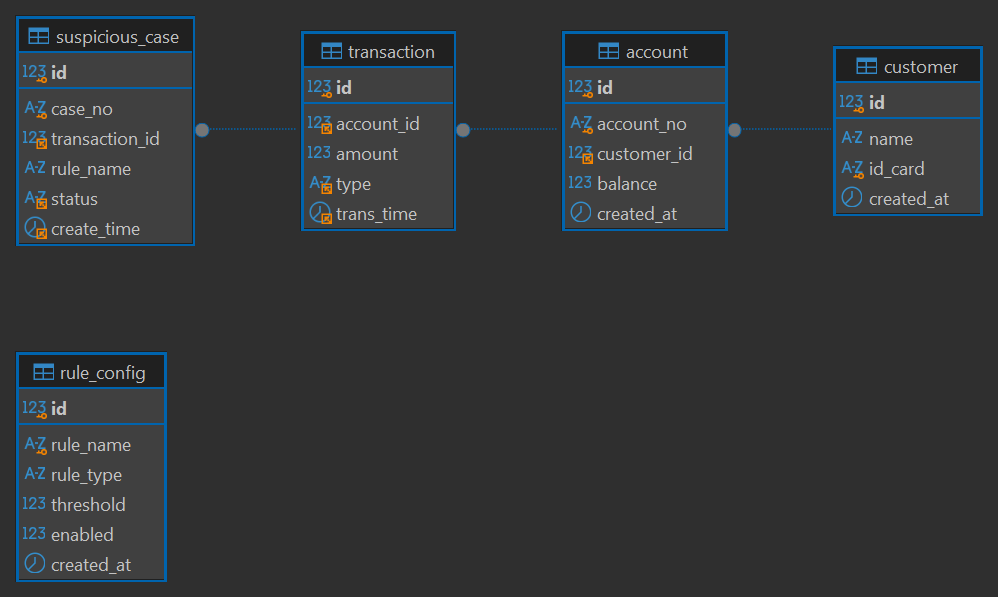

# mini-aml 反洗钱交易监测系统

## 当前版本 v0.4

相比 v0.3，新增：

- **数据库设计完善**
  - 补充完整的 ER 图（`src/main/resources/ER Diagram.png`）
  - 增加索引设计：`idx_account_time` / `idx_trans_time` / `idx_status` / `idx_create_time`
  - 说明每个索引的设计理由
- **SQL 能力强化**
  - 完成 5 道 SQL 递进大作业（`src/main/resources/sql/q1~q5.sql`）
  - 覆盖三表 JOIN、窗口函数、CASE WHEN、子查询、EXPLAIN 优化
- **性能优化记录**
  - JDBC 批量插入优化：`executeUpdate` 改为 `addBatch` + 每 1000 条 `executeBatch` 提交
  - 灌入 10 万+ 条测试交易数据（`SeedData.java`）
  - EXPLAIN 索引实验：验证最左前缀原则、索引失效场景（函数、类型转换）
- **事务实验**
  - 脏读、不可重复读、幻读的隔离级别实验
  - 理解 MySQL 默认 RR 级别下的 MVCC 快照读

## 技术栈

- Java 17
- Maven
- MySQL 8.4
- JDBC（mysql-connector-j）
- JUnit 5 + JaCoCo
- DBeaver（数据库客户端）
- Git

## 数据库设计

### ER 图

### 表结构说明

- `customer`：客户表，存储姓名和身份证
- `account`：账户表，一个客户可有多个账户
- `transaction`：交易流水表，存储所有进出账记录
- `rule_config`：规则配置表，动态控制规则阈值
- `suspicious_case`：可疑案例表，规则命中后自动生成

### 索引设计说明

- `idx_account_time` (account_id, trans_time)：复合索引，用于按账户查询时序数据，支持最左前缀
- `idx_trans_time` (trans_time)：单列索引，用于按时间窗口过滤交易流水
- `idx_status` (status)：用于按状态筛选可疑案例
- `idx_create_time` (create_time)：用于按创建时间排序案例

## 性能优化记录

### JDBC 批量插入优化

- 原始实现：循环内 `stmt.executeUpdate()` 逐条插入，每次插入都需网络交互
- 优化方案：循环内 `stmt.addBatch()` 装车，每 1000 条执行一次 `stmt.executeBatch()` + `conn.commit()` 发车
- 成效：灌入 10 万条测试数据时间大幅缩短

### EXPLAIN 索引实验结论

- 全表扫描（`type=ALL`）在 10 万数据下代价极高
- 复合索引需满足最左前缀原则，跳过最左列会导致索引失效
- 索引列上使用函数（如 `YEAR(trans_time)`）会导致索引失效
- 数据区分度低时（如 account_id 只有 1、2、3），优化器可能直接放弃索引

## 如何运行

1. 确保 MySQL 已启动并创建 `mini_aml` 数据库
2. 执行 `src/main/resources/schema.sql` 初始化表结构
3. 配置 `src/main/resources/db.properties`（参考 `db.properties.example`）
4. 运行 `SeedData.java` 可灌入 10 万条测试数据
5. 运行 `Main.java` 执行规则引擎并生成可疑案例